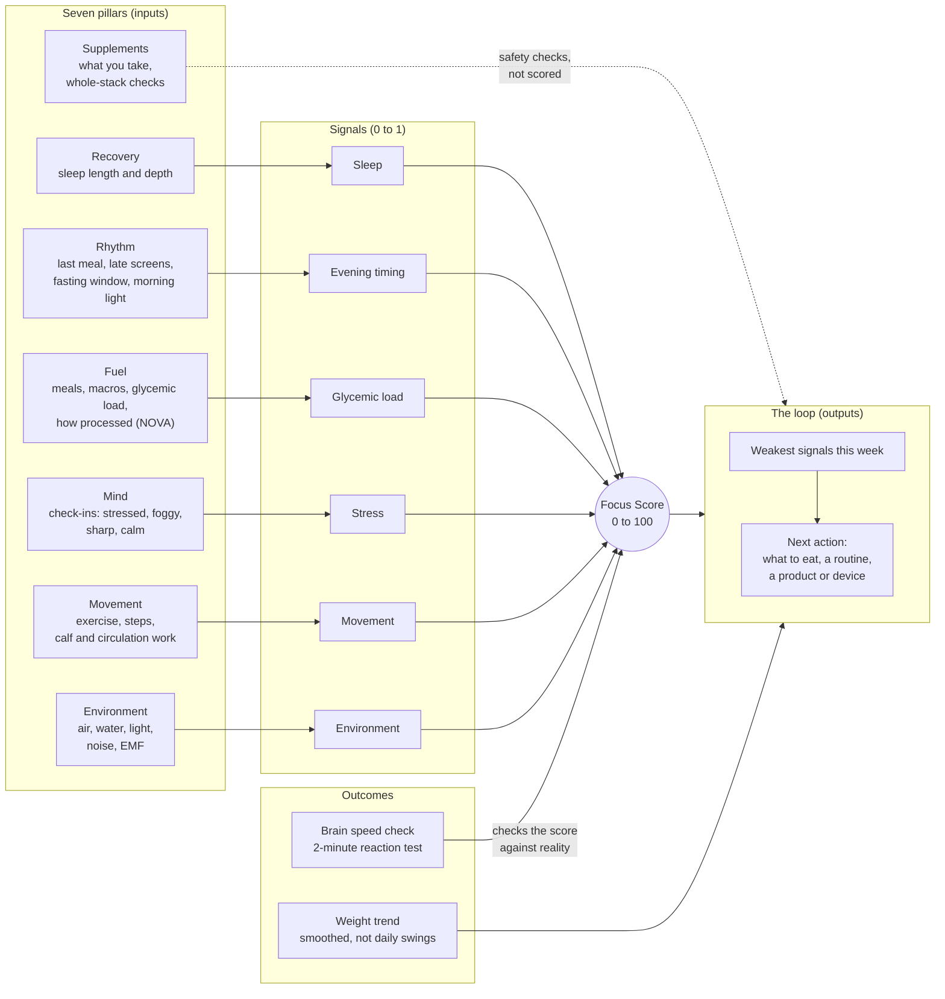
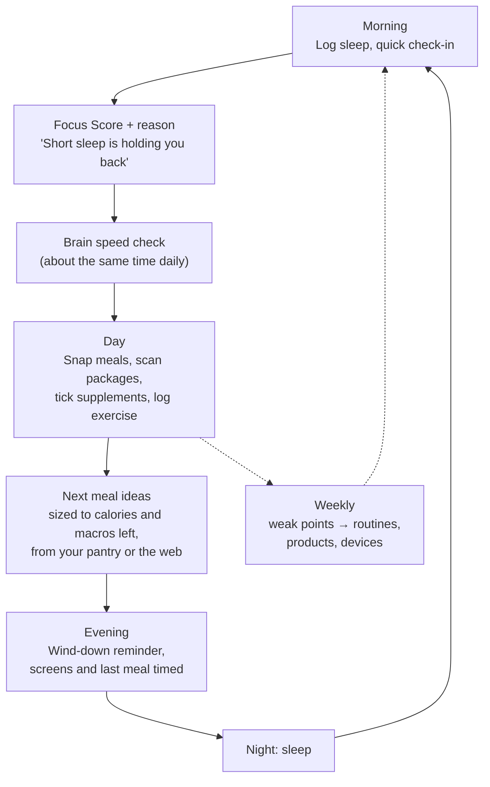
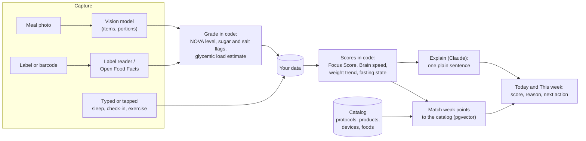
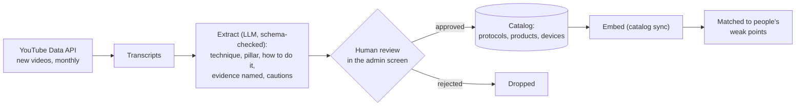

# NeuroCal Biohacking Model (NCBM)

*White paper, draft 2, October 2026*

## 1. The idea in one paragraph

What sharpens the mind also tends to lean the body: steady blood sugar, enough deep sleep, light and food at the right times, movement, fewer ultra-processed foods, and recovery from stress. Most apps take one of these on its own: a calorie counter, a sleep tracker, a fasting timer, a supplement list. NCBM treats them as **one system with one question**: *how much usable mental energy do you have today, and what moves it?* NeuroCal measures the inputs, scores the day, checks the score against a short reaction test, and turns what it learns into the next small action. It draws on functional medicine and the biohacking canon (Dave Asprey and *The Human Upgrade* first), explained so anyone can follow it.

## 2. Five principles

1. **One body, one score.** Every feature feeds the Focus Score or explains it. A feature that doesn't is left out.
2. **Your own baseline.** You're compared with your own usual, not a population average. A 70 is good if your usual is 60.
3. **Measured, not just felt.** The Brain speed check (a 2-minute reaction test after the PVT used in sleep research) is the outcome. Self-reports are inputs.
4. **The model decides; AI explains.** Scores are fixed formulas anyone can audit. Language models read labels and photos, explain scores and write recipes, always inside checked schemas. They never set a score.
5. **Knowledge is data, not code.** Protocols, products and devices live in a catalog that grows without app releases. New research lands in the catalog, not in a rewrite.

NeuroCal is a self-improvement tool, not a medical device. It doesn't diagnose or treat, and it says so wherever supplements come up.

## 3. The model

Seven pillars feed the signals. The signals make one daily score, two outcomes check it, and the loop turns weak spots into actions. Supplements aren't scored: they're checked for safety across the whole stack.

*Every pillar but supplements is in the score (v1.1).*

### 3.1 The Focus Score (v1.1, built)

A morning score for day D, built from the day before and the night:

| Signal | Weight | From | Good when |
|---|---|---|---|
| Sleep | 30% | Sleep that ended on D: 70% length (against 8 h), 30% deep sleep (against 90 min) | Long and deep |
| Evening timing | 20% | Last meal after 21:00 on D−1, screens from 22:00 to 04:00; +0.15 when the overnight fast reached the fasting plan's hours | Early dinner, screens off, fast kept |
| Glycemic load | 15% | Share of D−1's calories from high-glycemic-load food | Mostly low-GL |
| Stress | 15% | Negative check-ins (stressed, brain fog, low focus, wired) on D−1 and D | Few or none |
| Movement | 10% | Exercise on D−1 against 30 moderate minutes (hard counts double, light half) | 30 moderate minutes |
| Environment | 10% | D−1's mean US AQI where you live (Open-Meteo, town rounded to ~10 km) and that day's check: morning daylight, a dark bedroom, a quiet bedroom, filtered water | Clean air, habits kept |

A signal with no data is left out and the others are re-weighted, so a new user gets a score as soon as they log one thing. Movement only counts for people who've logged exercise in the past week, and environment only once a town is set or the check is done, so nobody is marked down for a habit they don't track. A signal under 0.75 is a **weak point**. The two weakest of the week are matched (by meaning, with pgvector) to routines and products in the catalog.

### 3.2 Weights tuned to each person (built)

After **14 days** with both a stored score and a Brain speed check, each signal's weight moves with how closely it tracked that person's Brain speed score on the same days: up to half more for a signal that rises and falls with their reaction time, up to half less for one that doesn't. A signal needs data on at least 10 of those days to move. The weights still add up to 1, and the standard weights above are the starting point and the fallback. The app says "Weights tuned to your Brain speed" when they've moved, so the score stays explainable.

### 3.3 Next

- **Calf and circulation work** gets extra credit within Movement, along with short walks after meals.
- **Light and noise from the phone's sensors**, and water quality by postcode, to add measured data next to the self-reported check.

## 4. A day in the loop

## 5. How a reading becomes advice

Every AI step sits behind a port with a schema. Anything the model returns that doesn't fit the schema is refused.

## 6. What's built and what's next

| Area | Status |
|---|---|
| Fuel: meal photos, food catalog, package scanner (barcode, label, NOVA, sugar, salt, best-before), pantry recipes, your own recipe's calories per serving (USDA values where ingredients match) | Built |
| Rhythm: evening timing, late screens, fasting timer and streak | Built. Morning light and wake-time consistency are next |
| Recovery: sleep logging, nights on one clock | Built. Wearable import next (Apple Health, Health Connect) |
| Mind: check-ins in three daily windows set from your wake time, nudging until you check in | Built |
| Movement: exercise with calories burned | Built, and in the score (v1). Calf and circulation routines next |
| Supplements: label scanning, stack, daily checklist, whole-stack limits and duplicates | Built |
| Outcome: Brain speed check with personal baseline | Built, and it tunes each person's weights (v1) |
| Weight: goal, smoothed trend, pace, projected date | Built |
| Environment: air quality where you live, and a daily check of daylight, a dark and quiet bedroom and filtered water | Built (v1.1). Water by postcode and light and noise from sensors next |
| Shopper: review a typed or photographed shopping list, with swaps and gadget picks | Built. Gadgets come from the catalog by rule (air fryer, water filter, ice cream maker, blender), with your affiliate links; a device scraper isn't planned |
| Knowledge pipeline (below) | Built |
| Levels (below) | Built |

## 7. The knowledge pipeline

New techniques should reach users without an app update. The source is long-form expert content, starting with Dave Asprey's YouTube channel and *The Human Upgrade*.

Nothing reaches users without a person approving it. Every protocol keeps a link to its source video and timestamp, so people can hear it in the expert's own words.

**As built.** YouTube only gives captions to a channel's own owner, so the monthly job (the 1st of each month, with `YOUTUBE_API_KEY`) lists new uploads on the watched channels (Dave Asprey's by default, `KNOWLEDGE_CHANNELS` to change) and the admin pastes the transcript on the admin Knowledge page (YouTube's "Show transcript"). Claude Haiku takes out up to 12 techniques, each with its pillar, steps, the evidence the speaker names, cautions and a quote with its timestamp. Transcripts are read once and not stored. An approved technique, optionally edited, becomes a routine tagged by its pillar, kept through catalog syncs, and shown with a link to its moment in the video.

## 8. Levels (built)

A simple ladder so people can see progress beyond one day's score. You move up by keeping habits over time, not by buying things. Each level needs every level below it, and holds only while its habits do. The app shows the level in Progress → Level, with every habit and how close it is.

| Level | Name | Reached when, over the last 28 days |
|---|---|---|
| 1 | Aware | Food logged on 14+ days and sleep on 14+ nights |
| 2 | Fuelled | Under 20% of graded calories ultra-processed; protein at 80%+ of target on average |
| 3 | In rhythm | Last meal and screens on time (timing ≥ 0.75) on 5 of 7 evenings; for people who fast, the window kept 5 of 7 days |
| 4 | Recovered | Sleep and stress signals averaging 0.75+; Brain speed this week at or above your usual |
| 5 | Upgraded | Movement and environment each averaging 0.75+ |

An average needs at least 10 days with data before it counts.

## 9. Limits

- The standard weights are a reasoned starting point, not fitted to outcomes across people. Section 3.2 fits them to each person once their own Brain speed data is enough; pooled, anonymised fitting across users is a later step.
- Calories and glycemic load from photos and labels are estimates. The app says so where it shows them.
- Brain speed is a self-check for comparing your own days, not a medical test.
- Supplement and device suggestions carry a note to check with a doctor or pharmacist, and are labelled when they're affiliate or own-brand.
