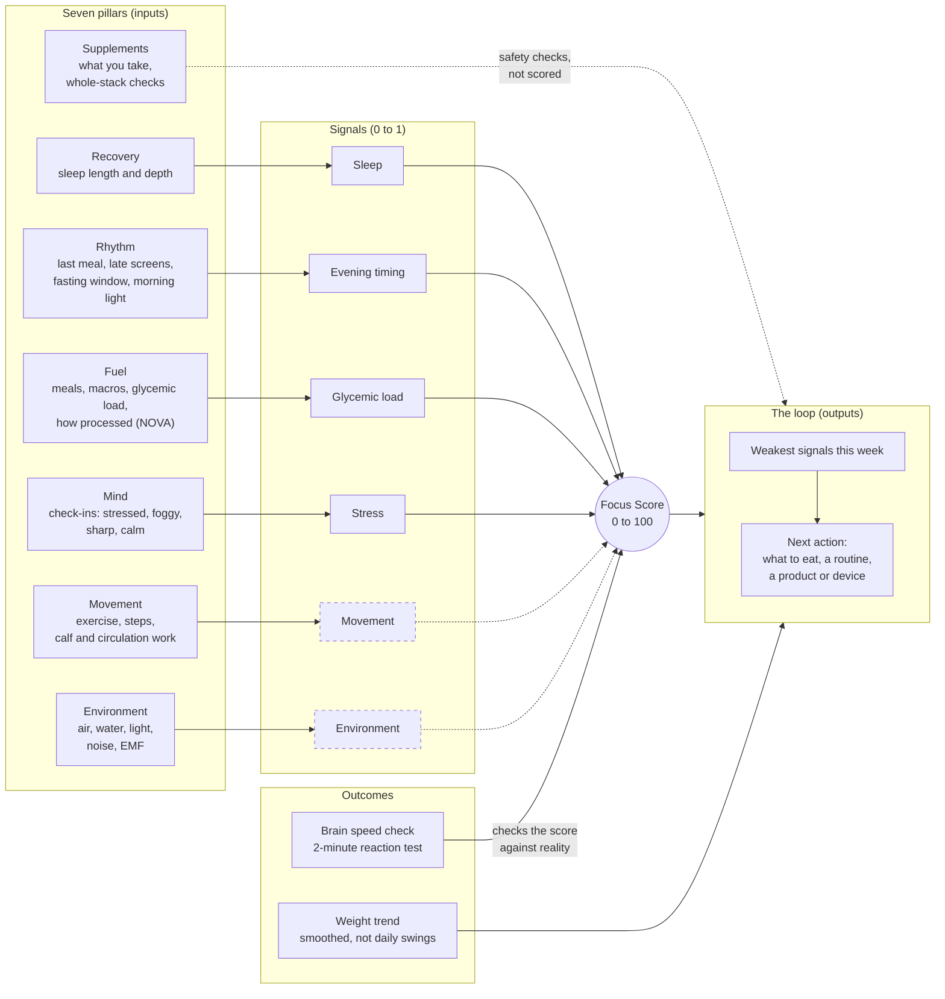
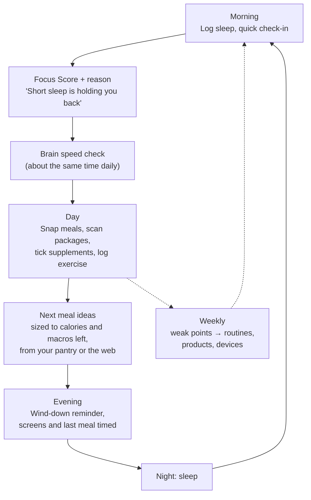
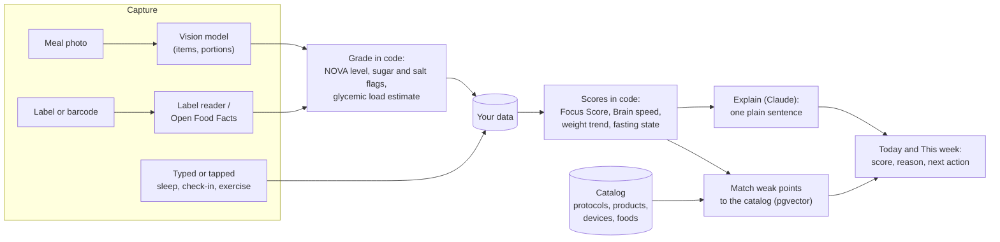
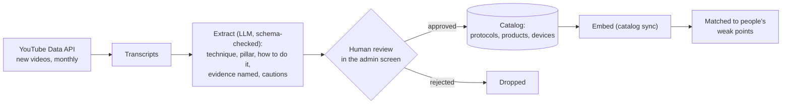

# NeuroCal Biohacking Model (NCBM)

*White paper, draft 1, October 2026*

## 1. The idea in one paragraph

What sharpens the mind also tends to lean the body: steady blood sugar, enough deep sleep, light and food at the right times, movement, fewer ultra-processed foods, and recovery from stress. Most apps take one of these on its own: a calorie counter, a sleep tracker, a fasting timer, a supplement list. NCBM treats them as **one system with one question**: *how much usable mental energy do you have today, and what moves it?* NeuroCal measures the inputs, scores the day, checks the score against a short reaction test, and turns what it learns into the next small action. It draws on functional medicine and the biohacking canon (Dave Asprey and *The Human Upgrade* first), explained so anyone can follow it.

## 2. Five principles

1. **One body, one score.** Every feature feeds the Focus Score or explains it. A feature that doesn't is left out.
2. **Your own baseline.** You're compared with your own usual, not a population average. A 70 is good if your usual is 60.
3. **Measured, not just felt.** The Brain speed check (a 2-minute reaction test after the PVT used in sleep research) is the outcome. Self-reports are inputs.
4. **The model decides; AI explains.** Scores are fixed formulas anyone can audit. Language models read labels and photos, explain scores and write recipes, always inside checked schemas. They never set a score.
5. **Knowledge is data, not code.** Protocols, products and devices live in a catalog that grows without app releases. New research lands in the catalog, not in a rewrite.

NeuroCal is a self-improvement tool, not a medical device. It doesn't diagnose or treat, and it says so wherever supplements come up.

## 3. The model

Seven pillars feed the signals. The signals make one daily score, two outcomes check it, and the loop turns weak spots into actions. Supplements aren't scored: they're checked for safety across the whole stack.

*Dashed: designed but not yet in the score.*

### 3.1 The Focus Score today (v0)

A morning score for day D, built from the day before and the night:

| Signal | Weight | From | Good when |
|---|---|---|---|
| Sleep | 40% | Sleep that ended on D: 70% length (against 8 h), 30% deep sleep (against 90 min) | Long and deep |
| Evening timing | 20% | Last meal after 21:00 on D−1, screens from 22:00 to 04:00 | Early dinner, screens off |
| Glycemic load | 20% | Share of D−1's calories from high-glycemic-load food | Mostly low-GL |
| Stress | 20% | Negative check-ins (stressed, brain fog, low focus, wired) on D−1 and D | Few or none |

A signal with no data is left out and the others are re-weighted, so a new user gets a score as soon as they log one thing. A signal under 0.75 is a **weak point**. The two weakest of the week are matched (by meaning, with pgvector) to routines and products in the catalog.

### 3.2 The Focus Score next (v1, proposed)

- **Movement joins the score.** Minutes and intensity from exercise logging, with extra credit for short movement after meals and for calf and leg work, which helps circulation back from the legs.
- **Fasting counts as rhythm.** Keeping the planned window adds to Evening timing.
- **Brain speed calibrates the weights per person.** After about 14 days with both a score and a Brain speed check, fit each person's weights to which signals actually moved their reaction time. Their score then reflects their body, not our guess. The v0 weights stay the starting point and the fallback.
- **Environment joins later** (section 6), once there is data to score.

## 4. A day in the loop

## 5. How a reading becomes advice

Every AI step sits behind a port with a schema. Anything the model returns that doesn't fit the schema is refused.

## 6. What's built and what's next

| Area | Status |
|---|---|
| Fuel: meal photos, food catalog, package scanner (barcode, label, NOVA, sugar, salt, best-before), pantry recipes | Built |
| Rhythm: evening timing, late screens, fasting timer and streak | Built. Morning light and wake-time consistency are next |
| Recovery: sleep logging, nights on one clock | Built. Wearable import next (Apple Health, Health Connect) |
| Mind: check-ins, daily reminders | Built. Check-in windows with repeat nudges next |
| Movement: exercise with calories burned | Built. In the score in v1; calf and circulation routines next |
| Supplements: label scanning, stack, daily checklist, whole-stack limits and duplicates | Built |
| Outcome: Brain speed check with personal baseline | Built. Per-person weights in v1 |
| Weight: goal, smoothed trend, pace, projected date | Built |
| Environment: air, water, light, noise, EMF | Not started. Air quality from a public API by location first; water by postcode; light and noise from the phone's sensors |
| Shopper: upload a shopping list, get a cleaner list and gadget picks | Not started. Device catalog and affiliate links exist |
| Knowledge pipeline (below) | Not started |
| Levels (below) | Not started |

## 7. The knowledge pipeline

New techniques should reach users without an app update. The source is long-form expert content, starting with Dave Asprey's YouTube channel and *The Human Upgrade*.

Nothing reaches users without a person approving it. Every protocol keeps a link to its source video and timestamp, so people can hear it in the expert's own words.

## 8. Levels (proposed)

A simple ladder so people can see progress beyond one day's score. You move up by keeping habits over time, not by buying things.

| Level | Name | Reached when, over the last 4 weeks |
|---|---|---|
| 1 | Aware | Logging food and sleep on most days |
| 2 | Fuelled | Under 20% of calories ultra-processed; protein near target |
| 3 | In rhythm | Last meal and screens on time 5 nights a week; fasting window kept |
| 4 | Recovered | Sleep and stress signals mostly good; Brain speed at or above your usual |
| 5 | Upgraded | Levels 1 to 4 held, plus movement and an environment check |

## 9. Limits

- The v0 weights are a reasoned proposal, not yet fitted to outcomes. Section 3.2 is how they get validated.
- Calories and glycemic load from photos and labels are estimates. The app says so where it shows them.
- Brain speed is a self-check for comparing your own days, not a medical test.
- Supplement and device suggestions carry a note to check with a doctor or pharmacist, and are labelled when they're affiliate or own-brand.
